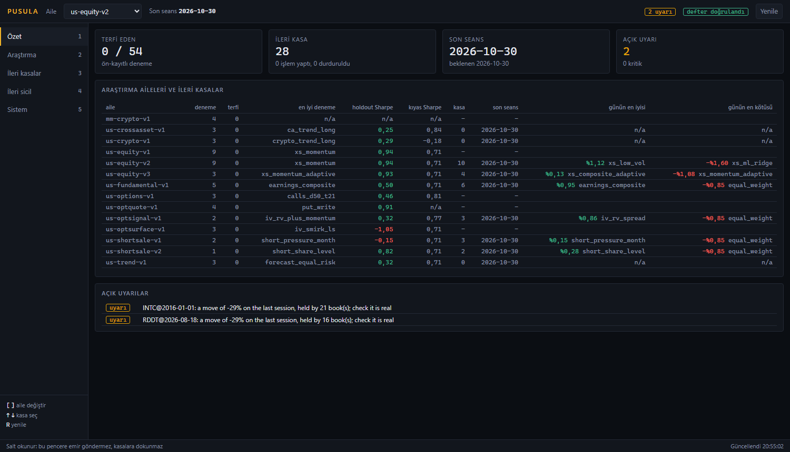
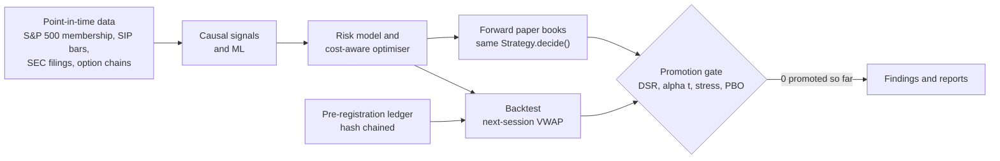
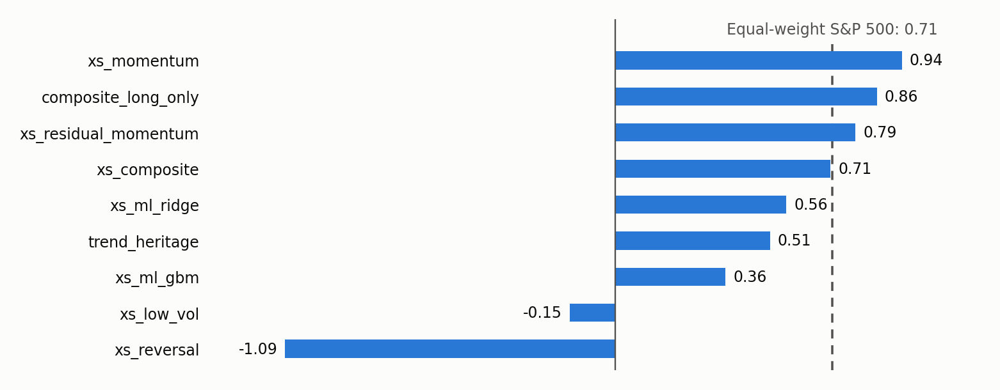
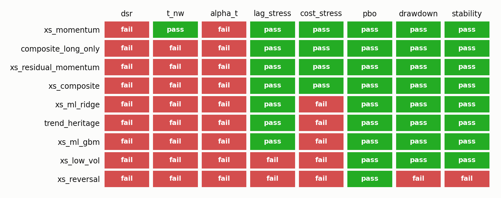
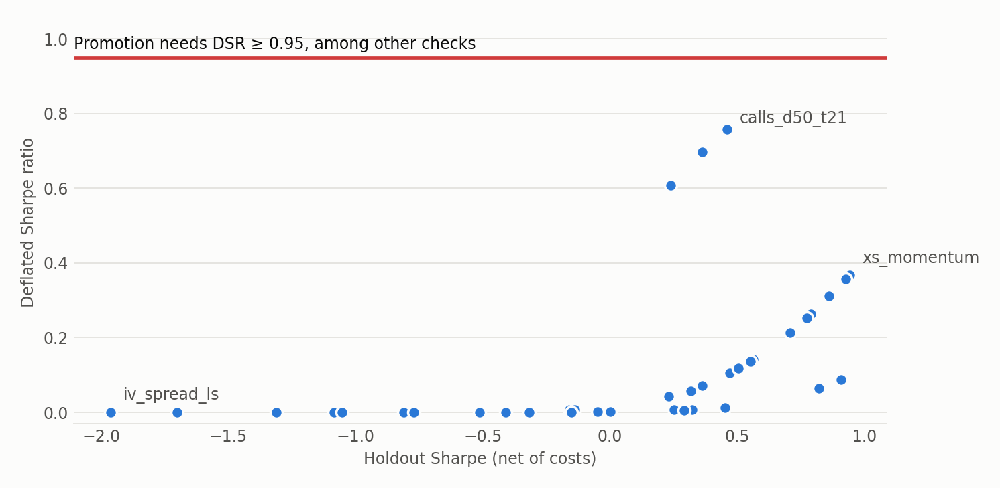

# pusula

[](https://github.com/xakii-112/pusula/actions/workflows/ci.yml)


**A directional systematic equity & options platform built to institutional research and
engineering standards.** Point-in-time data, causal signals, a calibrated cost model, a validated
factor risk model, a cost-aware optimiser, one code path from research to paper trading, and a
research protocol that will not let a backtest fool its author.

> *pusula* (Turkish: compass) is the ground-up rebuild of **NihaiAlgoritma**, a stock & options
> signal system written over 108 iterations. It keeps that project's idea (scan a universe, form
> directional views, size them under hard risk rules, express them in stock or options, track
> every mechanism in its own paper book) and its research discipline, and rebuilds everything
> underneath. Design rationale in Turkish: [docs/00_INCELEME.md](docs/00_INCELEME.md).



*The read-only dashboard (`pusula web`, interface in Turkish) on real forward books. It counts 54
candidates: the 50 US trials discussed below plus 4 market-making trials on crypto.*



## Results first

Every number below comes from pre-registered trials, net of a cost model calibrated on real
consolidated quotes, with execution at the next session's VWAP. Holdout window 2023-01-03 →
2026-10-22; Sharpe ratios on excess returns; the deflated Sharpe ratio counts all 21 trials of
the equity programme and their dispersion. Generated tables: [v2](docs/RESULTS_us-equity-v2.md),
[v3](docs/RESULTS_us-equity-v3.md), [v1](docs/RESULTS_us-equity-v1.md),
[options](docs/RESULTS_us-options-v1.md),
[option-implied signals](docs/RESULTS_us-optsignal-v1.md),
[company filings](docs/RESULTS_us-fundamental-v1.md),
[option surface](docs/RESULTS_us-optsurface-v1.md); interpretation:
[docs/FINDINGS.md](docs/FINDINGS.md).

| trial (us-equity-v2) | Sharpe | ann. return | max DD | FF5+MOM alpha (t) | DSR | gate |
|---|---:|---:|---:|---:|---:|---|
| `xs_momentum` (12-1, market neutral) | **0.94** | 16.9% | 9.9% | 7.0% (1.81) | 0.37 | rejected: DSR, alpha t |
| `composite_long_only` | 0.86 | 13.4% | 11.1% | 0.6% (0.18) | 0.31 | rejected |
| `xs_residual_momentum` | 0.79 | 14.7% | 9.2% | 5.1% (1.45) | 0.26 | rejected |
| `xs_composite` (6 anomalies) | 0.71 | 13.4% | 10.0% | 5.1% (1.25) | 0.21 | rejected |
| `xs_ml_ridge` / `xs_ml_gbm` | 0.56 / 0.36 | 10.5% / 7.6% | 7.9% / 7.0% | 2.8% / 0.4% | 0.14 / 0.07 | rejected |
| `trend_heritage` (NihaiAlgoritma's live `quant_trend`) | 0.51 | 10.2% | 14.0% | −3.5% (−1.22) | 0.12 | rejected |
| `xs_low_vol` / `xs_reversal` | −0.15 / −1.09 | 2.8% / −7.1% | 22.8% / 26.2% | negative | 0.01 / 0.00 | rejected |
| *equal-weight S&P 500 (benchmark)* | *0.71* | *14.6%* | *17.5%* | *−1.4%* | | |





**Nothing was promoted, and that is the result.** The only robust signal is momentum (it
survives a day of delay and doubled costs, every holdout year is positive), and it is the known
momentum factor (loading 0.59, t 21). Machine learning did not beat the linear composite; the
heritage trend strategy is a market-beta strategy below the benchmark; expressing the trend view
with calls priced at observed implied volatility lost to holding the same stocks (0.46 vs 0.81);
the implied-minus-realised-vol signal failed (−0.81). On the way, the protocol caught a first run
that reported Sharpe ratios of 12-83 (two real defects, see [FINDINGS §3](docs/FINDINGS.md)).

`us-equity-v3` then attacked two mechanisms the measurements exposed. A realised-volatility
feedback on the risk target worked: the market-neutral books realised 10.6-11.0% against the
10% target (v2: 12.3-12.5%; 9.6-10.0% in the development window). Scaling alpha by each signal's
trailing realised IC cut turnover by 20-30% but did not improve returns (momentum 0.93, composite
0.55). Not promoted either; and because v2's holdout had been seen, v3 can only ever be confirmed
by its forward record.

`us-fundamental-v1` then tested different information instead of new combinations of price
anomalies: company filings from SEC EDGAR, point in time to the second of acceptance, with
removed index members resolved to their own filers (729 of 731 securities). Earnings-release
reaction, standardised unexpected earnings, accruals and gross profitability all failed: their
rank ICs are below 0.025, insignificant in the holdout, and the announcement signals change
sign between 2019-2022 and 2023-2026 (best holdout Sharpe 0.50 against −0.58 in development;
FINDINGS §3c). The option surface's shape (smirk, call-put volatility spread, from 11 GB of
strike-level chains) failed too: no information in the S&P 500 since 2019 and features too noisy
to trade (~90 turns a year; FINDINGS §3d). Daily off-exchange short-sale volume from FINRA
(after fixing 26 members renamed since 2018, 7 of whose current tickers had carried another
company's volume) failed as well: the change in a stock's short share carries no information
(§3e); its level looked informative in a post-hoc diagnostic, but a backtest of it loses in
2019-2022 and is not promoted even on the holdout it was chosen from, so it runs forward only
(§3f).

`us-trend-v1` tested the one thing an earlier project on this machine had shown working: Nihai3's
portfolio engine (continuous forecast, hierarchical risk parity, no-trade buffer), which doubled
the old signal's Sharpe there, on today's survivors. On the point-in-time universe with calibrated
costs it does not beat the strategy it was meant to improve (0.31 vs 0.51, difference −0.20,
95% interval [−0.50, +0.12]); it lowers drawdown and turnover, and pays for that in return
(§3g).

`us-crossasset-v1` gave that engine its best remaining chance: trend across 18 asset-class ETFs,
QuantBot's universe, where the literature's evidence is and where clusters are real. Over the whole
window its best book is level with holding the funds (Sharpe 0.61 vs 0.67, difference −0.06, 95%
interval [−0.69, +0.53]), with less than half the drawdown; it paid in 2019-2022, made money in
2022 when holding them lost 8%, and lagged after (§3h).

Then the limits this project had listed about itself. **Crypto:** a survivorship-free top 100 from
every pair Binance has listed, gated against Bitcoin; trend earned 0.29 in the holdout against
Bitcoin's 1.02 (§3i). **Options:** strike-level chains, an SVI surface and American pricing, and
strategies at real bid and ask; writing puts earned 0.91, as 0.37 of the market with no alpha, and
calls at real quotes earned nothing (§3j). **Order book:** market makers on a recorded Binance book
with queue position tracked; adverse selection exceeded the spread before fees, on a very short
sample of 18 symbol-hours (§3k). **Impact:** Y measured at 0.91 on 5.5 million trades against the 0.7 assumed (§3l).
**50 trials, nothing promoted.**



*Every registered strategy that has both numbers, drawn straight from the ledger by
[tools/readme_figures.py](tools/readme_figures.py). None reaches the line; DSR is one of eight checks.*

## What is in the box

| layer | what | verified by |
|---|---|---|
| **data** | survivorship-free S&P 500 since 2016 (731 securities: members rebuilt from the dated change log, removed members priced *as of* their last index day), Alpaca SIP daily bars with VWAP and trade counts, content-hashed store, pointwise causal repairs, Fama-French 5 + momentum, 30-day ATM IV history; SEC EDGAR fundamentals (security master with verified CIKs for removed members, as-reported XBRL facts and earnings releases dated by EDGAR acceptance time, restatements never back-filled); option-surface features (smirk, volatility spread, term slope) reduced from DoltHub's strike-level chains while streaming; FINRA daily short-sale volume since 2018 (hash-chained files, used one session after publication, renamed members read under their earlier tickers) | offline universe reconstruction tests; quality report on every build (0 calendar deviations; 6,731 bad VWAPs repaired field-wise); fundamentals: acceptance-to-session mapping, as-known values under restatement, Q4 derivation, successor rejection, spot checks against published accounts; short volume: every member year's FINRA volume checked against its own bars (found 26 renamed members, 7 of whose current tickers had carried another company's volume) |
| **alpha** | causal operators and sixteen published anomalies (12-1 momentum, multi-horizon trend, weekly reversal, low volatility, residual momentum, 52-week high, betting-against-beta, overnight drift; earnings-announcement return, standardised unexpected earnings, accruals, gross profitability; implied-volatility smirk, call-put volatility spread, term slope; abnormal short selling); composite with beta neutralisation; IC / decay / turnover analytics | **mechanical look-ahead test** on every registered signal (truncate the future, the past must not move); leaky constructions are caught |
| **ml** | walk-forward ridge and gradient-boosted trees, purged + embargoed, refit quarterly | causality test; learns a planted signal, ignores noise |
| **risk** | statistical factor model (vol-scaled PCA, EWMA covariances, shrunk specific risk, volatility-regime adjustment), historical VaR / ES, seven historical stress scenarios, pre-trade gate (Reg T, name / net / sector / beta / turnover / ADV limits, price floor, restricted & hard-to-borrow lists), latching kill switch | out-of-sample **bias statistics** on real data, every session 2017-2022: 1.01 long-only, 1.03 long-short, 1.21 for optimised noise-alpha portfolios (the optimisation bias; seven model variants incl. eigen-adjusted covariance and industry factors measured, none removes it: [docs/CALIBRATION.md](docs/CALIBRATION.md)) |
| **execution / micro** | `pusula execute` mirrors one forward book, or all of them netted with fractional shares and crypto, in the Alpaca paper account (real orders, idempotent ids, fill reports, tracking against the mix), with a live path locked behind the gate, the forward record and an operator's arming; local order book from Binance's diff stream, queue-position market-maker replay, impact calibration from ticks; spread model calibrated on 439 NBBO samples, square-root impact, fees, borrow and margin financing, participation cap, order state machine with idempotent client ids, simulated broker, Alpaca paper adapter (dry-run by default), Almgren-Chriss and volume-profile scheduling | state-machine, idempotency, dry-run and fee tests |
| **portfolio** | cost-aware mean-variance optimiser in factor form (cvxpy / Clarabel, compiled once, re-bound per rebalance), feasibility by construction, strategies: optimised alpha (Grinold alpha = IC × vol × score), trend heritage, equal weight | constraint, feasibility and cost-response tests |
| **engine** | research backtester (decide at close, trade next session's VWAP, delisting, financing), production paper engine (integer shares, micro-dollar ledger, hash-chained journal, resumable), attribution | **parity test** (both engines, same market: daily returns within 5 bp, ρ > 0.999); exact P&L identity under random fills (Hypothesis); resume = uninterrupted run, bit for bit |
| **options** | American options on a tree with discrete dividends; SVI smiles with arbitrage penalties and a volatility surface; strategies at real bid and ask from strike-level chains; Black-Scholes-Merton prices and Greeks, safeguarded IV inversion (ITM via parity), listed strike grid, call overlay priced at observed IV | Hull reference values, put-call parity, Greeks vs finite differences, IV round trip |
| **research** | hash-chained pre-registration ledger, promotion gate (DSR with the registered trial count, Newey-West t, FF5+MOM alpha, execution-lag and 2× cost stress, PBO, drawdown, stability), study runner, report | Monte-Carlo calibrated statistics (PSR size under the null, E[max SR], NW size, FDR, PBO on noise), tamper and concurrency tests |
| **live / web** | forward shadow books for every registered trial (v2, v3, option-implied, filings, short-sale, trend, cross-asset), nightly bar, implied-vol, SEC filing and FINRA short-volume updates (corporate-action detection, append-only DoltHub feed, filing-index change detection; an SEC, FINRA or DoltHub outage skips only the families that read it), daily operations report, decision log (every trade and where the name stood on each signal) and `pusula explain`, forward record against the gate with MinTRL, a bootstrapped comparison to the benchmark and each signal's IC since registration (`pusula review`), dead-man check with Telegram alerts, a nightly digest and an external heartbeat (`pusula health`), read-only desktop program and dashboard | persistence, resume-equivalence, snapshot, report, mocked-feed and outage tests; alert de-duplication, retry and no-token-in-errors tests; tampered-journal detection; gate-on-record tests |

## Quick start

Tests need no keys and no market data. Fetching data needs an Alpaca account for bars; copy
[.env.example](.env.example) to `.env` and fill it in.

```bash
git clone https://github.com/xakii-112/pusula && cd pusula
uv sync
uv run pytest -n auto                       # 419 tests
uv run ruff check src tests && uv run mypy  # strict typing
export PUSULA_ENV_FILE=$PWD/.env             # ALPACA_API_KEY / ALPACA_SECRET_KEY
uv run pusula data fetch                    # point-in-time store (~3 min)
uv run pusula data fundamentals             # SEC EDGAR filings store (~10 min, no key)
uv run pusula data short-volume             # FINRA daily short-sale volume (no key)
uv run pusula data cross-asset              # the 18 ETFs of us-crossasset-v1
uv run pusula data crypto                   # every Binance USDT pair ever listed (~7 min, no key)
uv run pusula data option-chain             # strike-level chains (~1.5 h, 1.4 GB, no key)
uv run pusula data record-book --hours 24   # the live order book, for the market-making family
uv run pusula study run --workers 12        # registered family (needs `study register` once)
uv run pusula app                           # the desktop program (tools/install_shortcut.ps1
                                            # puts it on the desktop); `pusula web` in a browser
uv run pusula forward                       # nightly shadow books
uv run pusula execute --all                 # the orders mirroring every book; --send sends them to paper
uv run pusula review                        # forward record against the gate
uv run pusula health                        # is the nightly system alive?
uv run pusula web                           # http://127.0.0.1:8780
```

Operations: [docs/OPERATIONS.md](docs/OPERATIONS.md). Architecture: [docs/ARCHITECTURE.md](docs/ARCHITECTURE.md).
Protocol: [docs/RESEARCH_PROTOCOL.md](docs/RESEARCH_PROTOCOL.md).

## Engineering rules

1. **Point in time or nothing.** Row `t` of anything holds only what was known at the close of
   `t`. A test truncates the future for every signal and pipeline stage and requires the past
   to be unchanged.
2. **One code path.** The same `Strategy.decide()` and the same risk gate drive research and
   production; a parity test keeps them together.
3. **Every dollar reconciles.** The production ledger is integer micro-dollars; capital events
   never mix with P&L; `equity − contributions = realised + unrealised − fees + financing`
   holds with `==` after every event.
4. **Determinism.** No wall clock below `live`, no solver warm starts, named seeds. A resumed
   book equals an uninterrupted one bit for bit.
5. **Fail loudly.** No broad `except`, no silent `pass` (architecture test). Rejected targets
   keep the current portfolio and are journalled.
6. **Trials cannot be hidden.** Pre-registration, hash chain, DSR over every registered trial,
   stress tests that count as failures when missing.
7. **Measure the infrastructure before trusting it.** Costs were calibrated against quotes and
   the risk model against realised risk before any strategy ran on real data, and both
   calibrations found and fixed real problems (a 2.2× spread under-prediction, a 13-19% risk
   under-forecast).

## Honest scope

This is a research and paper-trading platform with no proven edge: 50 registered trials, none
promoted. It sends real orders to a paper account, every book netted together. It can reach a live account only through locks
that nothing here has earned, and it has never done so. Nothing in it is investment advice.

Daily strategies assume execution at the next session's VWAP plus a model of its cost (spread
calibrated on quotes, impact measured on ticks at about what the stress allows, participation cap).
The order-book work is a replay: it assumes a resting order leaves no footprint and estimates its
place in the queue from 100 ms diffs, on 3.4 hours of recording so far. Option strategies trade at
end-of-day quotes, without early assignment or margin beyond cash-securing. A crypto book trades on
US sessions, and its shorts stand for perpetual futures. The stock universe is the S&P 500; a small-cap
one needs paid membership data. Known limits are listed with each result in
[docs/FINDINGS.md](docs/FINDINGS.md) and [docs/00_INCELEME.md](docs/00_INCELEME.md).

## License

All rights reserved; published for viewing and evaluation. See [LICENSE](LICENSE). To ask about any other use, open an issue.
